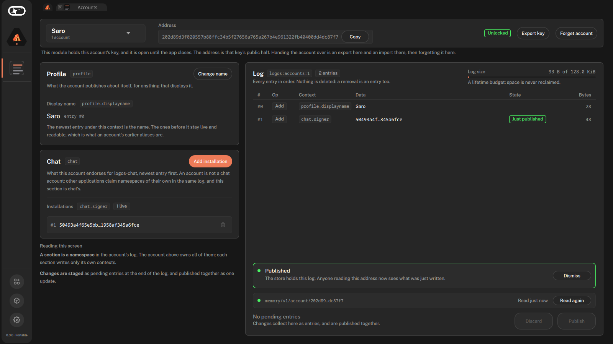

# Accounts

A [Logos Basecamp](https://github.com/logos-co/logos-basecamp) app that holds an
account's key and writes its [AccountLog](https://lip.logos.co/identity/raw/accountlog.html):
the signed, append-only log an account is. It also reads accounts whose key is
held elsewhere.



## Install

In Logos Basecamp 0.3.0 or later, open **Applications** and install
**Accounts**.

## What it does

- Creates an account, imports one made elsewhere, or observes one by address.
- Sets the account's display name (`profile.displayname`, per the
  [Account Profile](https://lip.logos.co/identity/raw/profile.html) spec) and
  endorses or revokes logos-chat installation keys (`chat.signer`).
- Stages edits and publishes them as one signed update: all of them or none.
- Seals a key with a password, per account, and exports or forgets it.

Keys stay in the app's vault, one file per account, in
`module_data/accounts_ui/vault`: under the `--user-dir` basecamp was started
with, or else under `~/.local/share/Logos/ui-host` on Linux.

## Where logs are published

Logs live in the account registry on the Logos Execution Zone
([account-registry-lez](https://github.com/logos-messaging/account-registry-lez)),
one per address, readable by anyone who holds it. The app reads them from the
LEZ sequencer (`https://testnet.lez.logos.co` by default) and verifies each one
before showing it.

A new account holds no funds yet, so an **account relay** can publish it
instead. Set one with **Set relay**, on the store strip or in the publish sheet:
its libp2p peer id and address, reached through the **libp2p** module. The app
keeps it beside the vault; `LOGOS_ACCOUNTS_RELAY_PEER` and
`LOGOS_ACCOUNTS_RELAY_ADDR` only fill it in until one is saved, and
`LOGOS_ACCOUNTS_RELAY_TOKEN` is sent to that relay alone, if it asks for a
token. The publish
sheet then offers to let the relay pay the fee, which is on by default; untick
it to pay with your own funds, for example when the relay refuses or is down.
See
[account-registry-lez](https://github.com/logos-messaging/account-registry-lez#account-relay).

Otherwise a publish is an `Append` transaction, and LEZ charges a fee for it, so the app
sends it through the **LEZ Wallet** module, which must be open. The first
public wallet account that can cover the fee pays; `LOGOS_ACCOUNTS_LEZ_PAYER`
names another, by its hex account id. The registry accepts a log only where it extends the one it
holds, and caps a log at 32 KiB. A published log is permanent.

By default the app uses the registry deployed on the public testnet,
`BHNNfnhPMNMZ7N3oAtbu1iM1HkFyraWx2UjBvxhj8wTa` (see
[Deployments](https://github.com/logos-messaging/account-registry-lez#deployments)).
`LOGOS_ACCOUNTS_REGISTRY_PROGRAM` names another, by its base58 account id.
`LOGOS_ACCOUNTS_LEZ_PAYER_KEY`, the hex key of a funded LEZ account, pays for
writes directly, with no wallet: with
`LOGOS_ACCOUNTS_SEQUENCER_URL=http://localhost:3040` that is how the app runs
against a local sequencer. `LOGOS_ACCOUNTS_STORE_URL` publishes to chat-store's
`/v1/account` instead, e.g. `https://devnet.chat-kc.logos.co`, with no wallet
involved.

## Develop

```sh
nix build   # the plugin
nix run     # the app in logos-standalone-app
```

`rust-core/` makes every account decision (vault, staging, store client) behind
the C ABI in `include/account_core.h`; `src/` is the Qt backend and the QML
view. `LOGOS_ACCOUNTS_SEQUENCER_URL` points the app at another LEZ sequencer,
and `memory` selects an in-process store; `LOGOS_ACCOUNTS_VAULT_DIR` moves the
vault.

The [tutorial](https://logos-co.github.io/logos-accounts-ui/) is executable:
CI builds the app, drives it through a whole account headless and publishes
the report. `.github/workflows/` has every check CI runs.

## License

MIT or Apache-2.0, at your option.
